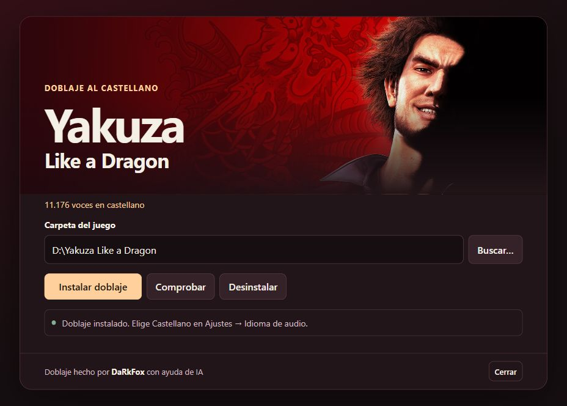

# Yakuza: Like a Dragon · Doblaje al castellano

El mod añade Castellano al selector de audio junto a Inglés y Japonés. Incluye 11.192 tomas dobladas, con la cinemática inicial del teatro y las exclamaciones finales del público.

Descarga el instalador de Windows o Steam Deck y el ZIP de voces desde la [release](https://github.com/darkfoxdeveloper/yakuza-like-a-dragon-castellano/releases/latest). Deja ambos archivos en la misma carpeta, cierra el juego y ejecuta el instalador. Tras instalar el doblaje, elige **Ajustes → Idioma de audio → Castellano** y reinicia el juego.

Consulta la compatibilidad y el estado de las pruebas en las notas de la release. El [código de los instaladores](./src) incluye las [instrucciones de compilación](./src/COMPILAR.md).
